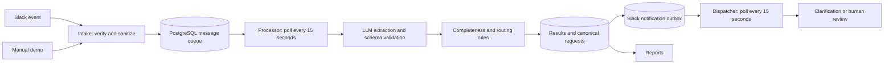

# Access Request Bot

A self-hosted n8n prototype that extracts infrastructure access requests
from Slack messages, validates them and prepares them for human review.

**The service never grants access.** It has no infrastructure provisioning
credentials or actions.

## Contents

- [Repository layout](#repository-layout)
- [Features](#features)
- [Requirements](#requirements)
- [Quick start: local demo](#quick-start-local-demo)
- [Thread example](#thread-example)
- [Slack setup](#slack-setup)
- [Architecture](#architecture)
- [Extraction contract](#extraction-contract)
- [Routing policy](#routing-policy)
- [Reliability and security](#reliability-and-security)
- [Configuration](#configuration)
- [Reports and evaluation](#reports-and-evaluation)
- [Operations](#operations)
- [Limitations and next steps](#limitations-and-next-steps)

## Repository layout

```text
bootstrap/import.mjs             Credential and workflow bootstrap
db/init.sql                      Schema, roles, queues and outbox functions
db/init.sh                       First-start database initialization
infra/webhook-proxy.conf          Webhook-only public proxy
workflows/processor.json          LLM processing and routing
workflows/demo-intake.json        Manual demo input
workflows/slack-intake.json       Slack event intake
workflows/notification-dispatcher.json
workflows/report.json            Operational reports
workflows/database-setup.json    Original setup workflow retained as reference
fixtures/gold.json               Reference evaluation cases
reports/actual.json              Recorded evaluation output
reports/evaluation.md            Quality evaluation
reports/cost.md                  Cost estimate
compose.yaml                    Core environment
compose.override.yaml           Optional Slack proxy and tunnel
.env.example                    Configuration template
.gitattributes                  Consistent LF endings for container scripts
```

The database setup workflow is not imported at runtime; initialization
uses db/init.sql and db/init.sh.

## Features

- Structured extraction with OpenAI gpt-4.1-mini.
- Multiple requests in one message.
- Clarification questions for missing details.
- Thread replies that update an existing incomplete request.
- Non-request classification.
- Schema validation and deterministic routing.
- Best-effort secret masking before persistence and LLM processing.
- Persistent PostgreSQL queues, retries and processing leases.
- Slack clarification, approval and DevOps review notifications.
- Processing and notification reports.
- Eight reference evaluation cases.

## Requirements

- Docker with Docker Compose v2.
- On Windows: Docker Desktop running Linux containers.
- An OpenAI API key with available API credit.
- Internet access for image downloads and model calls.
- For Slack mode: a Slack app, workspace and ngrok account.

The commands below use PowerShell. Host Python, Node.js, PostgreSQL and
n8n installations are not required.

After preparing configuration, start the environment with one command:

```powershell
docker compose up -d
```

## Quick start: local demo

### 1. Prepare configuration

Run from the repository root on a fresh checkout:

```powershell
if (Test-Path -LiteralPath .\.env) {
    throw '.env already exists. Edit the existing file instead.'
}

Copy-Item -LiteralPath .\.env.example -Destination .\.env

$envText = Get-Content -LiteralPath .\.env -Raw
$generator = [System.Security.Cryptography.RandomNumberGenerator]::Create()

try {
    foreach ($setting in @(
        'POSTGRES_PASSWORD',
        'APP_DB_PASSWORD',
        'N8N_ENCRYPTION_KEY'
    )) {
        $bytes = New-Object byte[] 32
        $generator.GetBytes($bytes)
        $value = -join ($bytes | ForEach-Object { $_.ToString('x2') })
        $envText = $envText -replace "(?m)^$setting=.*$", "$setting=$value"
    }
}
finally {
    $generator.Dispose()
}

[System.IO.File]::WriteAllText(
    (Join-Path (Get-Location).Path '.env'),
    $envText.Replace("`r`n", "`n"),
    [System.Text.UTF8Encoding]::new($false)
)

notepad .\.env
```

Set OPENAI_API_KEY to your own key and save the file.

Keep the local demo defaults:

```dotenv
SLACK_ENABLED=false
COMPOSE_PROFILES=
N8N_PORT=5680
PUBLIC_WEBHOOK_URL=http://localhost:5680/
```

Do not commit .env or share its contents.

### 2. Start

```powershell
docker compose up -d
```

Startup automatically:

1. Initializes PostgreSQL on its first start.
2. Creates the restricted application database role.
3. Imports encrypted n8n credentials and five workflows.
4. Publishes the scheduled processor.
5. Starts n8n.

Check startup:

```powershell
docker compose ps
docker compose logs --tail 80 n8n-bootstrap
```

The bootstrap container exiting with code 0 is expected.
Its final message should be:

```text
Bootstrap completed. Slack enabled: false
```

Open http://localhost:5680 and create the local n8n owner account.

No manual workflow import or credential creation is required.

### 3. Submit a demo message

Open the workflow **Access Request Intake**.

In **Edit Fields**, set:

```text
text: I need read-only access to Postgres in staging for 24 hours to verify a migration.
thread_ts:
```

Click **Execute workflow**.

The intake returns a pending message ID. The scheduled processor claims
work every 15 seconds. Allow time for the model call and processing.

Check the result:

```powershell
docker compose exec -T postgres psql -U postgres -d access_requests -c "SELECT id, status, error_code, result FROM access.messages ORDER BY id DESC LIMIT 3;"
```

Expected route: standard_approval.

Demo messages do not generate Slack notifications.

## Thread example

Submit the following two messages through demo intake.

First message:

```text
text: I need access to Grafana.
thread_ts: demo-thread-001
```

Wait until it is processed, then submit:

```text
text: Staging, viewer access for 48 hours to check dashboards.
thread_ts: demo-thread-001
```

The first message produces an incomplete request and one clarification
question. The reply fills its missing fields and updates the same request
UUID instead of creating another request row.

Thread context is scoped by workspace, channel, thread and author.
Conflicting or uncertain updates require manual review.

## Slack setup

### 1. Create and install the app

Create a Slack app and configure these Bot Token Scopes:

- channels:read
- channels:history
- chat:write

Install the app into the workspace. Reinstall it after scope changes.

Create three different channels:

- Source channel for requests: public.
- Human approval channel.
- DevOps review channel.

Invite the bot to all three channels. Approval and review channels may
be private when the bot is a member.

Collect the workspace ID, channel IDs, Bot User OAuth Token and
Signing Secret.

### 2. Configure the environment

Set these values in .env:

```dotenv
SLACK_ENABLED=true
COMPOSE_PROFILES=slack

SLACK_BOT_TOKEN=your-bot-token
SLACK_SIGNING_SECRET=your-signing-secret
SLACK_WORKSPACE_ID=your-workspace-id
SLACK_REQUESTS_CHANNEL_ID=your-source-channel-id
SLACK_APPROVALS_CHANNEL_ID=your-approval-channel-id
SLACK_REVIEW_CHANNEL_ID=your-review-channel-id

NGROK_AUTHTOKEN=your-ngrok-authtoken
NGROK_URL=https://your-assigned-domain.ngrok-free.dev
PUBLIC_WEBHOOK_URL=https://your-assigned-domain.ngrok-free.dev/
```

Use the domain assigned to your ngrok account.

NGROK_URL has no trailing slash.
PUBLIC_WEBHOOK_URL has a trailing slash.

For an existing instance, apply bootstrap configuration with:

```powershell
docker compose stop n8n
docker compose up -d
```

Check the tunnel:

```powershell
docker compose logs --tail 30 ngrok
```

### 3. Configure Slack events

In the Slack app settings:

1. Disable Socket Mode.
2. Enable Event Subscriptions.
3. Subscribe to the bot event message.channels.
4. Set Request URL to the **Production URL** shown by the Slack Trigger
   in **Slack Access Request Intake**.
5. Confirm that Slack shows the URL as verified and save the changes.

The production URL has the following shape:

```text
https://your-domain/webhook/<trigger-id>/webhook
```

Use the complete URL shown by n8n. A webhook-test URL is temporary and
is not the production endpoint.

### 4. Test delivery

Post this in the source channel:

```text
I need access to Grafana.
```

The bot should ask one clarification question in the message thread.

Reply in that thread:

```text
Staging, viewer access for 48 hours to check dashboards.
```

The updated request should appear in the human approval channel.

For DevOps review, test:

```text
I need admin access to Postgres in production for 6 hours to investigate an incident.
```

No approval or notification grants access automatically.

## Architecture



PostgreSQL stores business data and queue state.
n8n uses its own persistent SQLite database for workflows and encrypted
credentials.

The Slack intake, processor and notification dispatcher are separate
workflows. A persisted queue allows processing and delivery to recover
from failures independently.

Polling an empty queue does not invoke the model.
Each scheduled worker claims one item per tick: the baseline is roughly
four claims per minute per workflow, before backlog and processing delays.

## Extraction contract

The model returns message_type and a requests array.

Allowed message types:

- access_request
- non_request
- ambiguous

Each extracted request contains:

```json
{
  "target_request_id": null,
  "subject": "self",
  "resource": "postgres",
  "environment": "staging",
  "permission": "read_only",
  "duration_hours": 24,
  "reason": "verify a migration"
}
```

Missing information is represented by null.
The schema is embedded in the processor's Structured Output Parser.

The application validates thread targets and computes complete,
missing_fields, risk_flags, route and clarification_question.

Invalid model output follows the failure path; it is not accepted as
a valid request or automatically sent for standard approval.

## Routing policy

| Resource | Allowed environments | Allowed permission |
|---|---|---|
| grafana | development, staging | viewer |
| postgres | development, staging | read_only |

Request routes:

- standard_approval: complete request with no risk flags.
- needs_clarification: incomplete request with no risk flags.
- manual_review: a source, validation or policy risk is present.

Manual review takes precedence over completeness.

Risk examples include production access, elevated permissions, unknown
resources, values outside the resource policy, durations over seven days,
requests for another beneficiary, detected secrets and instruction attempts.

A clean non-request is ignored.
Flagged or ambiguous messages require manual review.

The policy is implemented in **Apply Routing Rules**, not decided by
the LLM. New resources and permissions require an explicit policy change.

## Reliability and security

- Slack Signing Secret is configured in the imported credential.
- Unsigned and invalid-signature production probes were rejected with HTTP 401.
- Slack intake accepts only the configured workspace and source channel.
- Bot messages and unsupported event subtypes are filtered.
- Source message IDs are deduplicated in PostgreSQL.
- Secrets matching supported patterns are masked before persistence and
  model processing.
- Source security flags are carried into deterministic routing.
- LLM processing has no tools or infrastructure access.
- SQL uses parameterized inputs.
- Thread updates validate author, scope, target UUID and existing fields.
- Queue claims use locks, lease tokens and lease expiry checks.
- Processing failures have bounded retries and fall back to manual review.
- Notification jobs are created transactionally with processing results.
- Notification delivery has independent leases and bounded retries.
- Slack success requires both a successful HTTP response and ok=true.
- Workflow execution data saving is disabled.
- PostgreSQL has no published host port.
- The n8n editor is bound to localhost.
- The tunnel proxy exposes POST requests under /webhook/ only.
- Application credentials use access_worker rather than the PostgreSQL
  administrator.

The .env file and Docker host remain trusted local configuration.
Anyone administering that host can access service secrets and stored data.

## Configuration

| Variable | Purpose |
|---|---|
| COMPOSE_PROJECT_NAME | Names the isolated Compose stack and volumes |
| N8N_PORT | Local editor port; default 5680 |
| GENERIC_TIMEZONE | Workflow timezone; default Europe/Kyiv |
| POSTGRES_PASSWORD | PostgreSQL administrator password |
| APP_DB_PASSWORD | Restricted access_worker password |
| N8N_ENCRYPTION_KEY | Stable key for n8n credential encryption |
| OPENAI_API_KEY | API key used by the model |
| OPENAI_MODEL | Model ID; default gpt-4.1-mini |
| SLACK_ENABLED | Enables Slack workflows when true |
| SLACK_BOT_TOKEN | Slack bot credential |
| SLACK_SIGNING_SECRET | Slack request verification secret |
| SLACK_WORKSPACE_ID | Allowed workspace |
| SLACK_REQUESTS_CHANNEL_ID | Allowed source channel |
| SLACK_APPROVALS_CHANNEL_ID | Human approval destination |
| SLACK_REVIEW_CHANNEL_ID | DevOps review destination |
| PUBLIC_WEBHOOK_URL | Public n8n webhook base URL |
| COMPOSE_PROFILES | Set to slack to start proxy and tunnel |
| NGROK_AUTHTOKEN | ngrok account credential |
| NGROK_URL | Assigned HTTPS domain without trailing slash |
| NGROK_IMAGE | Pinned ngrok image |

Bootstrap replaces the template workspace/channel IDs with configuration
values and creates credentials from environment variables.

Keep N8N_ENCRYPTION_KEY stable for an existing n8n volume.

PostgreSQL initialization scripts run only for an empty database volume.
Changing APP_DB_PASSWORD in .env does not change an existing database
role password; rotate the role and credential together.

## Reports and evaluation

Open **Access Request Report** and execute it.

Inspect **Execute a SQL query** for the overall processing summary:

- Pending, processing, processed and failed messages.
- Non-request and manual-review messages.
- Total, complete, incomplete and risky canonical requests.

Inspect **Notification Delivery Summary** for notification statuses and
delivery counts.

**Check Thread** automatically shows the latest demo thread.

**Check Slack** shows recent messages from the configured Slack source.
It may return no rows in local demo mode.

Evaluation artifacts:

- fixtures/gold.json: eight reference messages and expected fields.
- reports/actual.json: persisted results from the new Compose instance.
- reports/evaluation.md: field comparison and observed differences.
- reports/cost.md: model pricing and cost assumptions.

To repeat the evaluation, submit reference messages through demo intake
in order. Use the thread field from the fixture; gold-002 and gold-003
share a thread. Wait for gold-002 to process before submitting gold-003.

Use new thread labels for another evaluation run so previous context
does not affect results.

The recorded run matched all structured fields and routes. Exact reason
agreement was 2/8; six differences were an added leading "to".
The evaluation report preserves exact and normalized results separately.

Estimated model cost for 1,000 calls is USD 1.28 under the assumptions
in reports/cost.md. This is not a measured billing total.

## Operations

Inspect services:

```powershell
docker compose ps
docker compose logs --tail 80 n8n-bootstrap
docker compose logs --tail 80 n8n
```

Inspect queue state:

```powershell
docker compose exec -T postgres psql -U postgres -d access_requests -c "SELECT id, status, attempts, error_code FROM access.messages ORDER BY id DESC LIMIT 20;"
```

Restart n8n without reimporting workflows:

```powershell
docker compose restart n8n
```

Apply exported workflow or bootstrap configuration changes:

```powershell
docker compose stop n8n
docker compose up -d
```

Bootstrap imports the committed workflow exports again. Export any UI
changes you want to keep before running it.

Stop the environment:

```powershell
docker compose stop
```

Business data and n8n configuration are stored in named Docker volumes.
Back up both volumes and the encryption key before migration or recovery.

## Limitations and next steps

- Secret masking and instruction detection are pattern based and do not
  cover arbitrary sensitive content or attacks.
- Demo intake has fewer masking patterns than Slack intake; unify them.
- Detection patterns are mainly English; expand Ukrainian coverage.
- Native Slack intake can acknowledge an event before database persistence.
  Add a durable ingress boundary to reduce event-loss risk.
- Notification delivery is at least once. Slack acceptance followed by a
  lost database acknowledgment can cause duplicates.
- Notification retries do not yet honor Slack Retry-After.
- Pending notifications may become stale after later thread updates.
- Context and automatic thread updates are deliberately constrained;
  ambiguous cases require humans.
- Eight reference messages are a smoke evaluation, not a production
  accuracy estimate.
- Token usage, prompt versions, richer audit history, retention policies,
  automated backups and monitoring need further work.
- Polling trades simplicity for latency and limited throughput. Add an
  immediate worker wake-up while keeping periodic recovery polling.
- Human approval occurs outside the bot; provisioning is out of scope.
